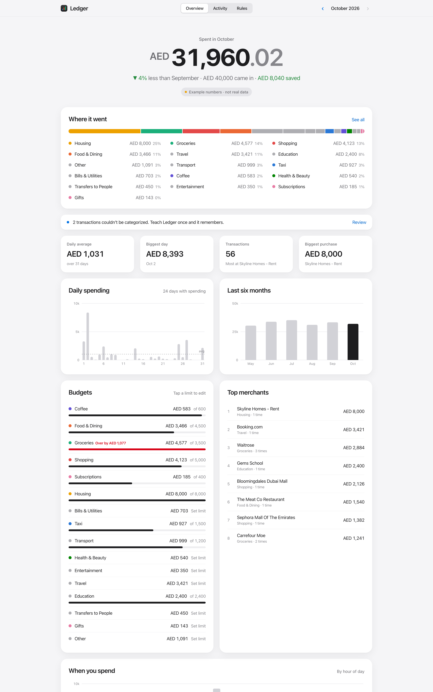
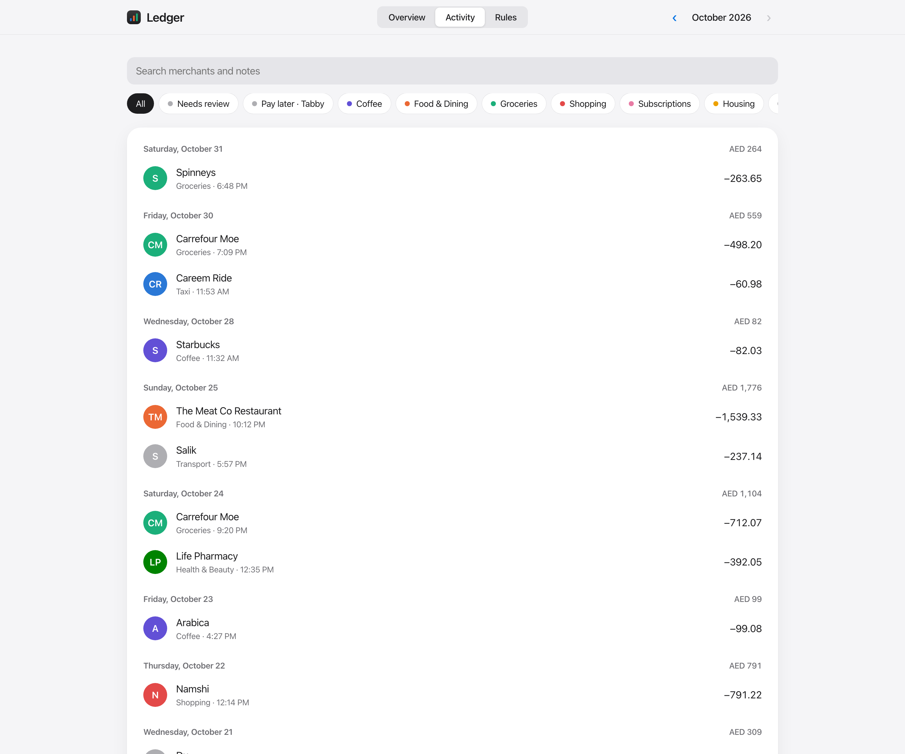
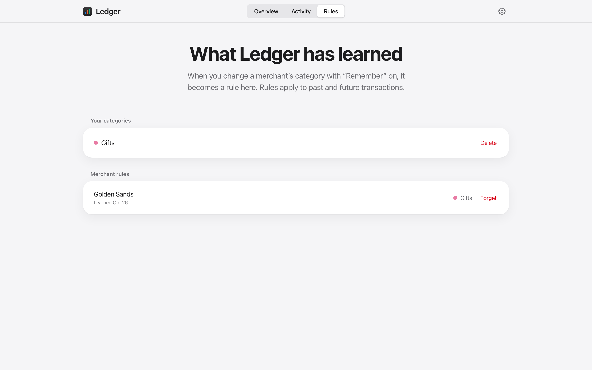
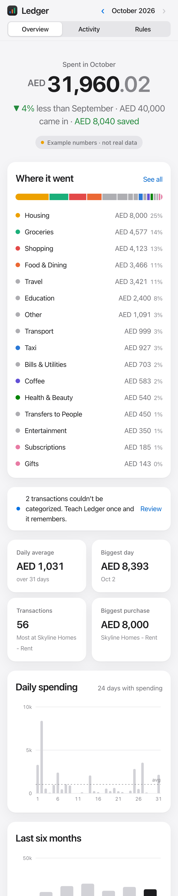
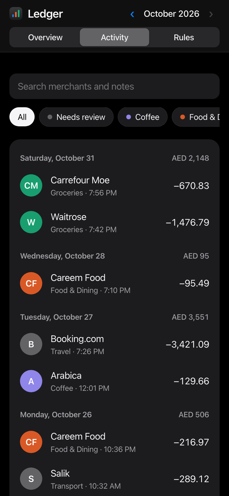
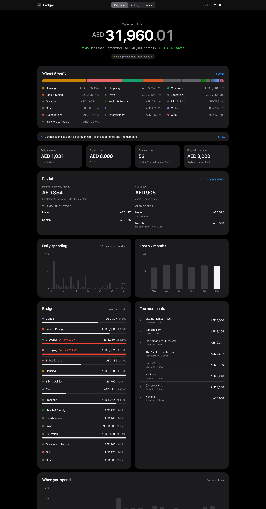

<p align="center">
  
</p>

<h1 align="center">Ledger</h1>

<p align="center">
  Your bank already emails you every transaction.<br>
  Ledger turns those emails into a private, beautiful monthly budget — on your own machine.
</p>

<p align="center">
  
</p>

---

## Why

Most budgeting apps want your bank password, or a paid aggregator that doesn't support your bank. But your bank already sends an email for every card payment and transfer. Ledger reads those alerts (read-only), understands them, and gives you a clear picture of where your money goes. No third party in between, and no data leaving your laptop.

## What it does

- **Reads your bank alerts from Gmail.** Read-only OAuth, with only the bank's sender addresses queried. You can also import a Google Takeout `.mbox`.
- **Understands them.** Each bank is a small YAML file of patterns. Card purchases, account debits, transfers and credits become structured transactions. Mashreq (UAE) is built in, and adding your bank takes no code.
- **Removes double counting.** Banks often send two emails for one movement (a transfer receipt and a debit alert). Ledger pairs them and keeps one.
- **Knows what isn't spending.** Moving money between your own accounts is tracked separately and never inflates your monthly total.
- **Learns from one correction.** Tell it once that *Golden Sands* is Shopping, or that a transfer to someone is between your own accounts. That merchant is handled the same way, past and future, from then on. Every learned rule is listed and can be undone. A rule can also be tied to one exact amount, for when one app covers different things (your AED 32.50 coffee order on a food-delivery app, say).
- **Understands pay-later.** A card charge that just says "Tabby" is paired with Tabby's own email (same amount, seconds apart) and shown as the real store, e.g. "Noon · via Tabby". Charges covering several orders are split. A Pay later card shows this month's instalments and what you still owe per order. Providers are YAML profiles too, so Tamara or Postpay can be added the same way.
- **Your categories, not just ours.** Create a category from any transaction in two taps (name and colour), then budget and teach rules with it like a built-in one.
- **Shows you the month.** Totals against last month, what came in and what you saved, a category breakdown, daily and hourly spending, a six-month trend, budgets per category, and top merchants. Light and dark mode, desktop and phone.

<p align="center">
  
  
</p>
<p align="center">
  
  
  
</p>

## Try it in one minute (demo data)

```bash
git clone https://github.com/amojahedi/inbox-ledger && cd inbox-ledger
python3 -m venv .venv && source .venv/bin/activate
pip install -r requirements.txt
INBOX_LEDGER_DATA=demo-data python -m inbox_ledger demo
INBOX_LEDGER_DATA=demo-data python -m inbox_ledger serve
```

Open http://127.0.0.1:8765. Everything in the demo is synthetic, and the dashboard labels it as example data.

## Use it with your own email

1. **Create a Google OAuth client.** This is free and takes about 3 minutes.
   In [Google Cloud Console](https://console.cloud.google.com/): create a project, enable the **Gmail API**, configure the OAuth consent screen (External, add yourself as a test user), then go to *Credentials → Create credentials → OAuth client ID → Desktop app*. Download the JSON and save it as `data/credentials.json`.
2. **Sync**, which opens a browser once to grant read-only access:
   ```bash
   python -m inbox_ledger sync
   ```
3. **Open the dashboard:**
   ```bash
   python -m inbox_ledger serve
   ```

Run `sync` again whenever you like. It only fetches emails newer than the last one it saw.

Prefer not to connect Gmail? Export your mail with [Google Takeout](https://takeout.google.com) and run `python -m inbox_ledger import path/to/mail.mbox`.

## Add your bank

Copy [`inbox_ledger/defaults/banks/mashreq.yaml`](inbox_ledger/defaults/banks/mashreq.yaml) to `data/banks/yourbank.yaml` and edit it. The file covers:

- `gmail_query`: which emails to fetch
- `senders`: which sender addresses this profile handles
- `patterns`: one regex per email type, with named groups `amount`, `currency`, `last4`, `merchant`, `counterparty`, `when`, `transfer_type`, `status`
- `dedupe`: which alert mirrors which receipt

Pay-later providers live in [`defaults/paylater/`](inbox_ledger/defaults/paylater/) and follow the same idea: patterns for the provider's emails, plus `card_merchant`, the name the bank alert shows.

Then run `python -m inbox_ledger rebuild`. Raw emails are stored, so improving a pattern re-parses your whole history instantly. Pull requests with new bank profiles are very welcome.

Categories, keywords and FX rates live in [`categories.yaml`](inbox_ledger/defaults/categories.yaml). You can override them with `data/categories.yaml`.

## Bring your own Claude (optional)

If your bank is not supported yet, Claude can help. This is **off by default** and always uses **your own** Anthropic API key and account: nobody else pays for it, and nothing is sent anywhere until you opt in.

- **`ai-read`** reads alert emails that no bank profile understood and turns them into transactions (marked as AI-read, with a confidence).
- **`ai-profile`** drafts a bank YAML profile from up to 5 of your stored emails, checks locally that it parses them, and saves it to `data/banks/`.

Set it up:

```bash
pip install -r requirements-ai.txt
export ANTHROPIC_API_KEY=sk-ant-...                 # your key, read from the environment, never stored
echo '{"enabled": true}' > data/ai.json              # the opt-in
python -m inbox_ledger ai-read --dry-run             # shows exactly what would be sent, sends nothing
python -m inbox_ledger ai-read                       # asks for confirmation (or pass --yes)
python -m inbox_ledger ai-profile --bank "My Bank" --from alerts@mybank.com
```

AI is on only when both the key and `data/ai.json` exist. Delete either to switch it off. `sync` and `rebuild` never contact Anthropic.

**What is sent.** Only emails your profiles could not parse and that look like bank alerts (an amount plus words like debited or purchase). For each: the subject and the first ~1200 characters of the body, with links and email addresses removed, long numbers masked down to their last 4 digits, and footers cut. No sender, no other mail. `ai-profile` additionally sends the sender address and up to 2500 characters of each of up to 5 sample emails. Every command prints this before it does anything and needs `--yes` or an interactive "y". Data goes to Anthropic's API under your account and their terms.

**Cached, once per email.** Answers are stored in `data/ledger.db` (`ai_transactions`), so an email is sent at most once, and `rebuild` uses the cache offline. Re-reading is never needed unless you delete the table.

**Cost.** It uses the cheapest current Haiku (`claude-haiku-5-5`, change with `LEDGER_AI_MODEL`). Emails are batched 10 per request at about 150 tokens each, so a thousand emails is roughly 150k input tokens, about two cents at Haiku prices; the command prints an estimate first and the real token usage after.

**No API key?** Use Claude Code in this repo: the [`add-bank` skill](.claude/skills/add-bank/SKILL.md) walks it through writing your bank's profile from 2 or 3 redacted sample emails, rebuilding, and checking nothing is left unparsed.

## Privacy

- Gmail access is **read-only** (`gmail.readonly`), and only your bank's sender addresses are queried.
- Everything is stored in a local SQLite file in `data/`, which is git-ignored, as are `credentials.json` and `token.json`.
- The server binds to `127.0.0.1`. There is no telemetry and there are no external requests from the dashboard: no CDNs, fonts or analytics.

## How it works

```
Gmail / .mbox ──▶ raw_messages ──▶ bank YAML patterns ──▶ transactions
                                                      │
                     merchant normalization ◀─────────┤
                     mirror dedupe          ◀─────────┤
                     learned rules › keywords › kind  ◀┘
                                                      ▼
                                  FastAPI ──▶ dashboard (vanilla JS + SVG)
```

| Layer | Choice | Why |
|---|---|---|
| Parsing | Declarative YAML + regex | New banks without code; rebuildable from raw emails |
| Storage | SQLite | One file, zero setup, easy to back up |
| API | FastAPI | Typed, small, self-documenting at `/api/docs` |
| UI | Vanilla JS, hand-drawn SVG charts | No build step, no dependencies, fast |
| Design | System font (SF Pro), HIG-inspired | Feels native on Apple devices; colour-blind-safe palette in both themes |

## Development

```bash
pip install -r requirements-dev.txt
pytest
```

## License

MIT
